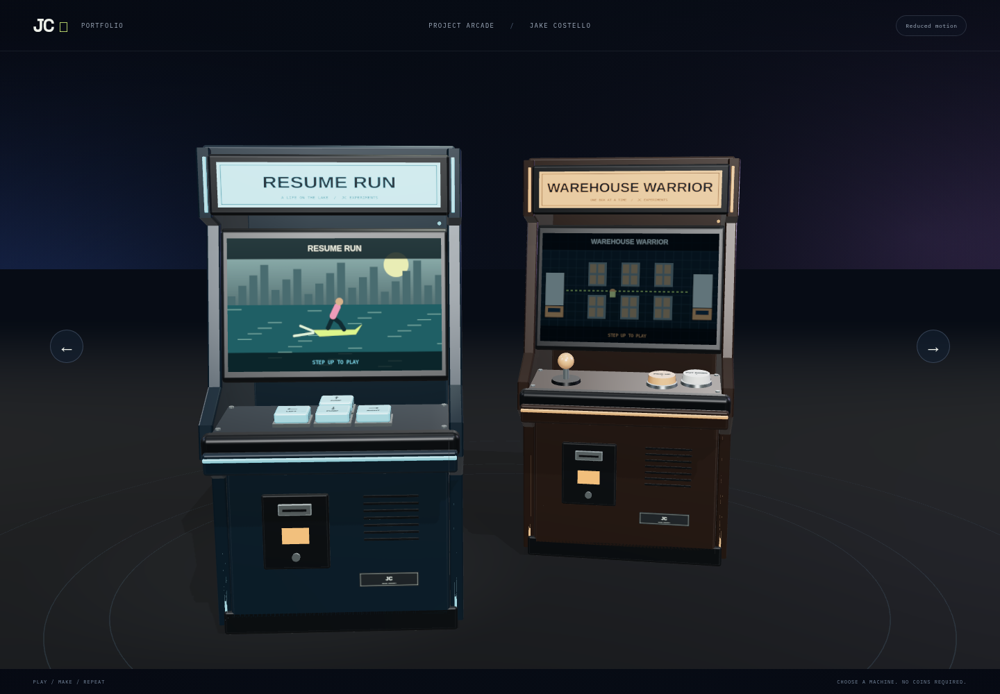
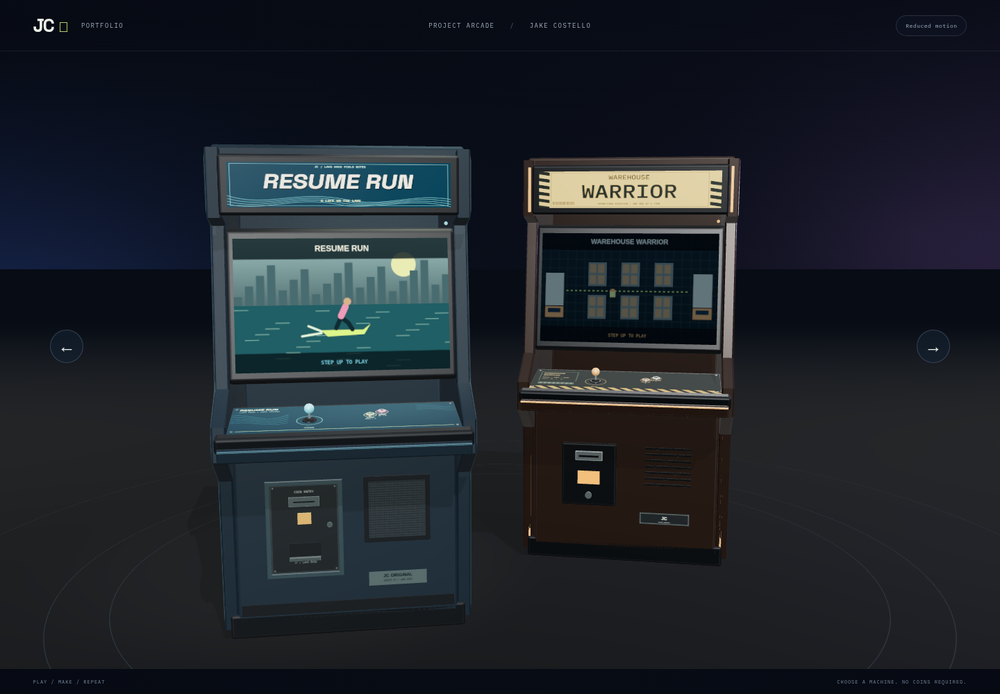
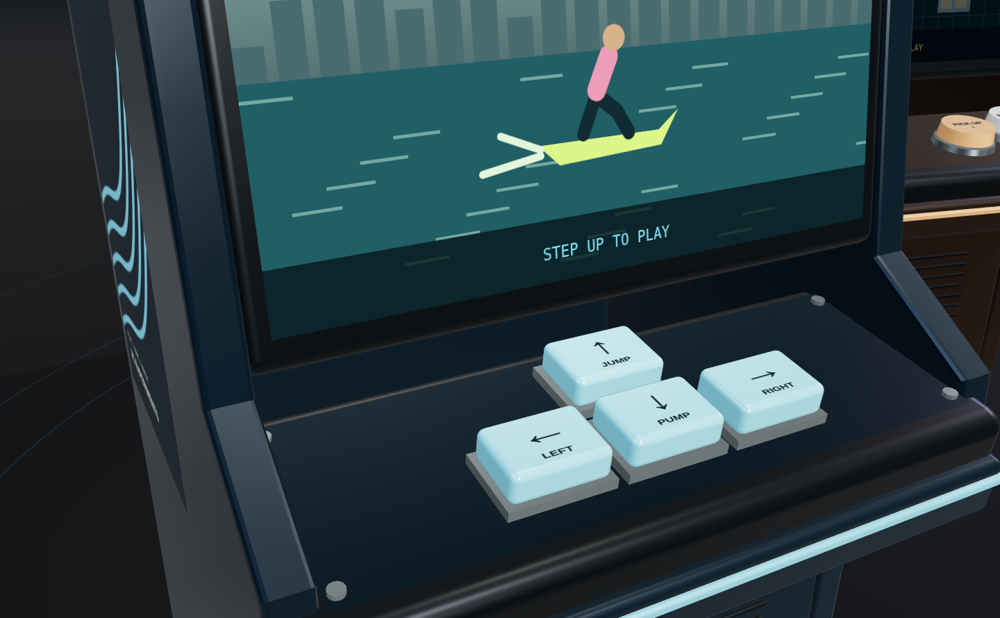
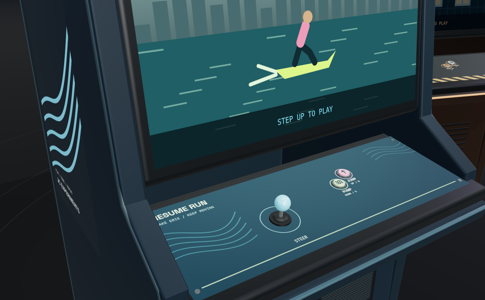
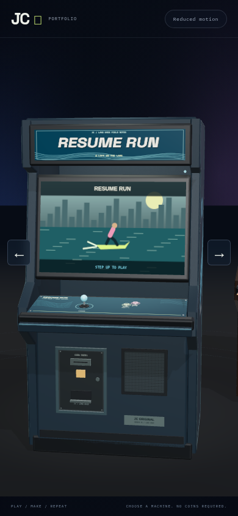
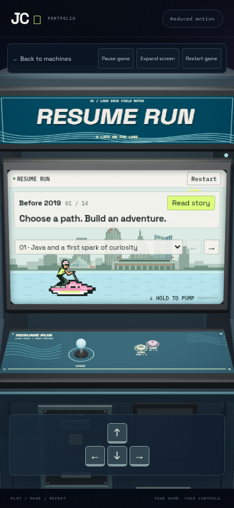
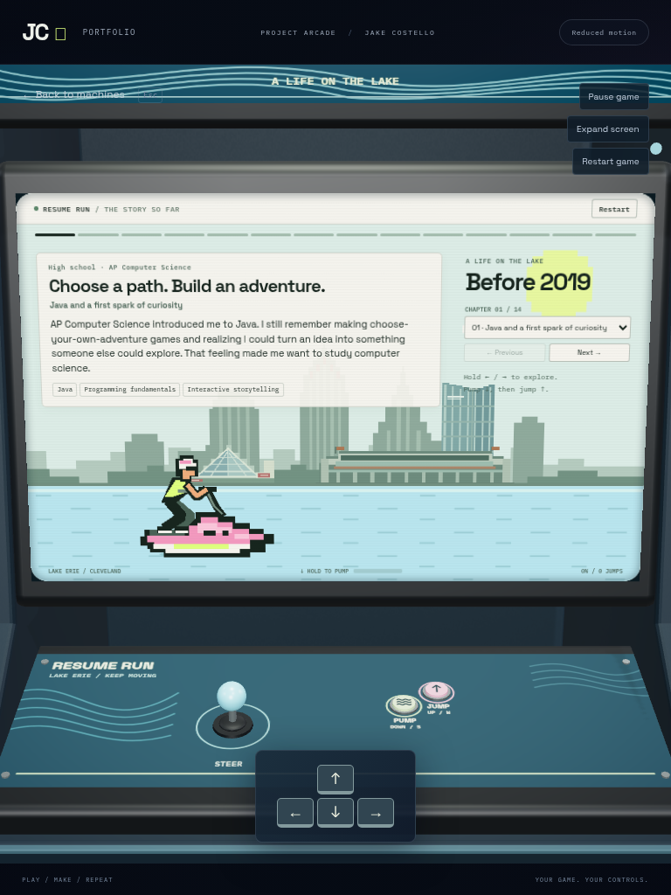

# Arcade cabinet evidence — 2026-11-13

Base: `7c36bef366a586bdf52e20954e93166461a7dc5f`. Branch:
`art/realistic-resume-cabinet`. Original procedural graphics and geometry; existing
Space Grotesk and IBM Plex Mono fonts, no downloaded commercial art or new packages.
Reference provenance and art direction: [ARCADE-ART-DIRECTION](../ARCADE-ART-DIRECTION.md).

Both cabinets now use a fixed joystick mount, pivoting shaft and two small round
action buttons. Resume Run retains its side waves with lake/sports panel art;
Warehouse Warrior uses shipping labels, hazard marks and crate graphics. Resume's
finish also gains continuous PVC trim, laminate and recessed coin/speaker hardware.
Screen/deck projection anchors, DOM and keyboard controls, fallback, demand render
and loading boundaries remain. The lobby Resume yaw intentionally changes slightly
to reveal depth; screenshots use matching viewport/camera setups otherwise.

## Desktop comparison

Before:

After:

Control deck before:

Control deck after:

## Mobile and tablet

Matching before views and three-quarter images are included beside this report.

## Measured cost

Same cloud host, Node 24.22.1, Chromium 156.0.8078.79, software GPU, DPR 1,
reduced motion; desktop 1440×1000, tablet 768×1024, mobile 390×844. One worker,
local frontend with external browser traffic denied. Renderer counters include
submitted render work and are not unique mesh polygon totals.

| View | Calls before → after | Triangles | Geometries | Textures | Programs | Entry ms |
| --- | --- | --- | --- | --- | --- | --- |
| desktop | 166 → 147 | 66,966 → 51,344 | 104 → 98 | 20 → 22 | 10 → 10 | 8,743 → 7,795 |
| tablet | 163 → 145 | 66,282 → 51,280 | 102 → 96 | 20 → 22 | 10 → 10 | 8,509 → 7,191 |
| mobile | 128 → 108 | 56,012 → 41,194 | 82 → 73 | 15 → 16 | 10 → 10 | 8,195 → 6,218 |

Each `*-metrics.json` contains the raw 30-frame forced-invalidation diagnostic,
CPU geometry-buffer byte estimate and entry timing. Those samples include startup
scheduling artifacts and heavily software-limited rendering; they cannot certify
real-device FPS, GPU memory, field performance or statistically reliable startup
improvements. New artwork adds two textures while reducing submitted geometry.
No extra lights, shadow passes, persistent loops or postprocessing were added.

The before/after joystick matrices show the original mount rotating with the stick
(max element delta about 0.179); all three final views measure zero mount movement.

## Validation at evidence capture

- Typecheck, 110 frontend unit tests and production build pass. Build retains the
  large renderer chunk warning; no new dependency or loading architecture change.
- Workbench tests: 10 pass; 14 skills / 558 pinned files verified, read-only.
- Focused desktop/mobile joystick and three-touch release tests: 4 pass.
- Capture/diagnostic suite: 7 pass, 2 expected skips (tablet-only diagnostics).
- Full arcade suite, extended tablet functional checks and PR workflow are gates
  still to run at this checkpoint; their final outcomes belong in the PR and
  archived workspace report. No deployment is claimed by this checkpoint.

Initial three-touch failures were a test harness error: CDP `touchEnd` specifies
lifted fingers, not remaining fingers. A minimal raw pointer probe established
that; the test now checks both release directions and cancellation without
weakening assertions. Joystick release also checks pointer identity.

Earlier strict animated-tablet checks failed before physical-cap assertions.
Matched unchanged-main traces also show delayed exact opacity 1 on this host.
The separate tablet lab config allows 15 seconds for exact opacity 1; shipped
behavior and desktop/mobile assertion defaults are unchanged. Final animation
trace reached exact opacity 1. Do not present that allowance as improved timing.

## Limits and follow-up

This is self-review, not independent review or accessibility certification.
Real touchscreen hardware, GPU memory and sustained hardware FPS remain unmeasured.
Prioritize real phone/tablet input and render profiling next, followed by the
user's subjective review of proportions and each game's art identity. Keep the
larger DOM controls as the accessible alternative to small realistic hardware.
