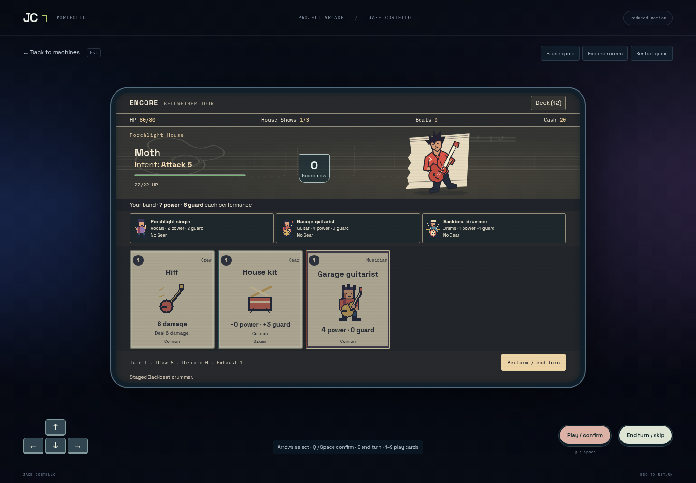
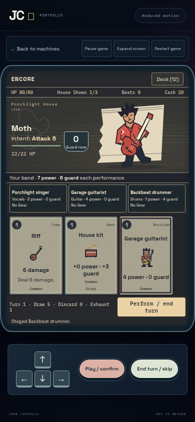
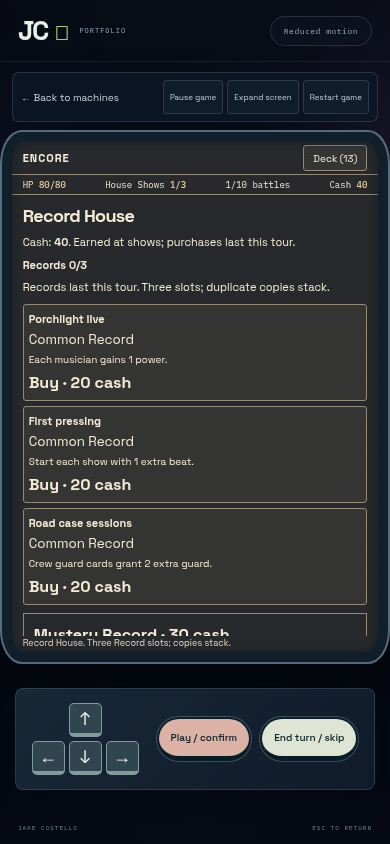
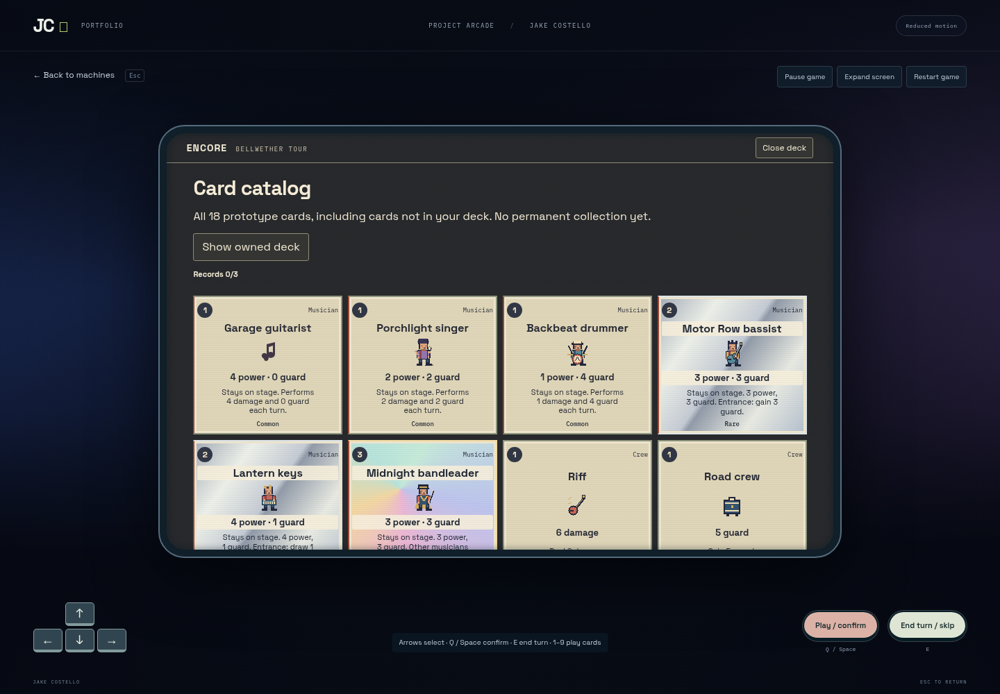

# Encore: band / deck prototype

Historical iteration: superseded by [roads and pressure](../encore-pressure/README.md).

Encore is an original rock-band tour through Bellwether, a fictional town. Its payphone connection is to Jake's senior project; neither Cleveland nor a commercial game's fiction is used as a claim about that project. Influences are structural, not copied cards, characters or artwork.

## Playable rules

- Twelve-card starter deck, opening hand of five, maximum hand of ten. Every opening includes a musician. Three beats per turn, three stage slots, one Gear per musician.
- **Musicians** stay on stage between turns. **Crew** resolves once, then discards or exhausts. **Gear** targets a compatible musician; replacing Gear or a musician sends the displaced cards to discard. Replacing a musician also removes its Gear. Canceling a target spends nothing.
- **Perform / end turn** deals the band's power, adds its guard, then resolves the visible enemy intent. A killing performance prevents the response. Unplayed hand discards, beats reset, unused guard clears, and five new cards draw. Stage/Gear reset between shows. Exhaust resets between shows.
- The pool has eighteen cards: six per type; each type has three common, two rare and one super rare. Rewards offer three different cards, or skip. Common cards have matte frames, rare silver finishes, super rare prismatic finishes. Labels also name the rarity.
- Start with 80 HP and 20 cash. Normal shows award 20 cash; each of three world bosses awards 30 and heals up to 20 HP. Crown Hall is a separate tenth/final show. Alternate town roads select real opponents. No final-show cash farming.
- One optional stop follows each normal show. **Record House** sells tour-long perks (three slots; duplicate copies stack). Three common shelf offers, with a fourth rare in 28% of visits or super rare in 2%. Prices: common 20, rare 50, super rare 90. One mystery pull per visit costs 30: exactly 70% common / 27% rare / 3% super rare. This is local earned game currency, with no real-money purchase or account.
- Full Record racks require an explicitly displayed replacement slot before purchases/rewards. A blind mystery purchase replaces that selected Record even if the new one is common. Boss Record rewards give two common choices plus one rare (3% chance of a super rare instead).
- **Tattoo Parlor** sells one permanent-for-this-tour bonus for 40 cash and a visible maximum-HP reduction: first-musician beat discount (−8 HP), performance guard (−5), or extra opening draw (−10).
- **Backline — Music Store** sells common Gear and upgrades individual musician/Gear copies. First level costs 25, second 40, maximum +2. Each level increases each nonzero power/guard stat by one. Crew cannot upgrade.

The initial design deliberately separates card rewards, persistent Records, tattoos and equipment. There is no permanent collection, account, save, multiplayer, fusion, stage/field-card type or audio system yet. Runs reset on leaving/reload. Card catalog shows the whole prototype pool; it does not pretend those cards are owned.

## Replace the art by hand

Rules and stable instance IDs live in `src/arcade/games/deckbuilder-model.ts`. Card IDs/names/stats/effects/rarity are in `band-cards.ts`. Do not edit either just to replace art.

`encore-art-registry.ts` maps illustration keys to local PNG/SVG files, `rendering: 'pixel' | 'smooth'` and optional CSS object position. `CARD_ART` has thirteen placeholder keys; several Crew/Gear cards intentionally share illustrations. Replace a file at the same path, or point the key to another local file. Keep paths relative to the site's Vite base (no leading slash). The UI owns title/type/cost/stats/upgrade/rarity text and finishes, so they survive any illustration swap. Missing files fall back to a musical note without removing rules or controls.

- Card sprites: transparent 32×40 PNG, up to ten opaque colors each, consistent upper-left light. Render at integer sizes using nearest-neighbor. Higher-resolution hand-drawn art may use `smooth`; it does not need to imitate pixel art.
- Enemy overrides: set `ENEMY_ART[characterKey]` to a local asset. Omitted/broken assets retain the current named vector portrait. Existing enemy keys are on `Encounter.character`; HTML retains identity/health/intent.
- Background overrides: set `VENUE_ART.house`, `.garage`, `.venue`, `.crown`. The current guitar/staff backdrop remains the fallback, and card slots are live HTML rather than painted hit targets.
- A future sprite sheet can extend presentation metadata with frame rectangles, durations and pivots. Never make animation completion resolve damage or consume resources. Preserve reduced motion, pause, focus and static alternatives.

`node tools/encore-art/build.mjs` regenerates the original placeholders. It is local and uses Node built-ins. `png.mjs` is the MIT PNG encoder from pinned PixelFX `patch-gg/pixelfx@5294518ce7c72e48b6100a744596e0acf57f2826`; its notice is beside it. No remote generation or paid API is configured.

## Verification and balance limits

`npm test` includes the actual reducer's stage/attachment zone invariants, deterministic rewards/stock, atomic targeting/purchases, health/upgrade caps, exact mystery ticket boundaries, turn-order effects and boss/final gates. Browser tests operate the public UI, including full ten-show tours, all shops, targeting cancellation, keyboard/touch, pause/reset, art failure, catalog finishes and reduced motion. Browser fixtures/mock services avoid production calls.

Run the finite probe with `npx tsx tools/encore-balance/run.ts /tmp/encore-balance`. It imports the actual reducer and three visible-state policies (offense, defense, setup); no hidden deck order or RNG access. Same 100 seeds and alternating routes per policy; 1,800-action cap; invariants checked after each action. Policy shop/reward heuristics are fixed and not optimal human choices.

Initial result: **300/300 wins**, no budgets exceeded, mean ending HP 56.54 / 69.46 / 67.91. Every policy earned 210 and spent 185 per tour. This demonstrates reliable completion and also an overly forgiving prototype under these heuristics. It does not establish human enjoyment or balance. It excludes deliberate bad decisions, alternative purchase policies, long-term collection, human playtests and audio/animation quality.

## Next design decisions

1. Reduce the dominance of repeated passive band guard through demonstrated enemy counterplay, gear tradeoffs or musician exposure. Compare the same seeds before changing numbers; add a careless/no-setup baseline and human playtests.
2. Give each district/boss a readable battle-of-the-bands mechanic rather than only intent/portrait differences. Keep intents truthful and avoid surprise targeting rules.
3. Decide deck collection versus tour reset, then version a local save format before adding a binder. Collecting should not erase the option to skip rewards.
4. Test shop opportunity costs and multiple Record/tattoo purchase policies. Current prices are hypotheses, not a finished economy.
5. Explore musician/Gear fusion only after the underlying choices hold up. Choose whether it belongs at the Tattoo Parlor, Backline or a separate event; preserve stable card identity/art keys.
6. Replace shared icons with hand-drawn card illustrations and district background art. Animation sheets are presentation, never a second rules engine.

## Local browser evidence

Real UI captures, reduced motion, desktop 1440×1000 and phone 390×844. Placeholder art is intentionally replaceable. Catalog capture deliberately blocks guitarist artwork to verify the readable fallback. Other captures load the generated sprites normally.

