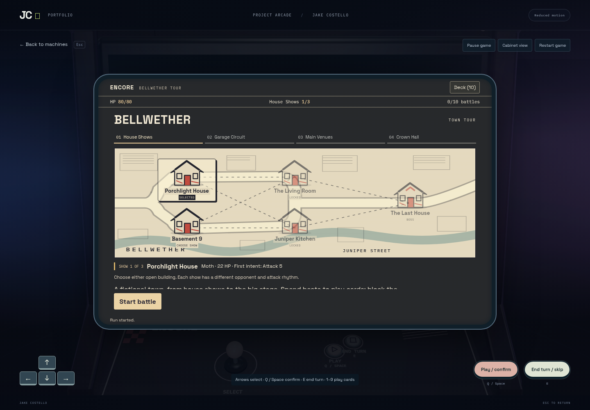
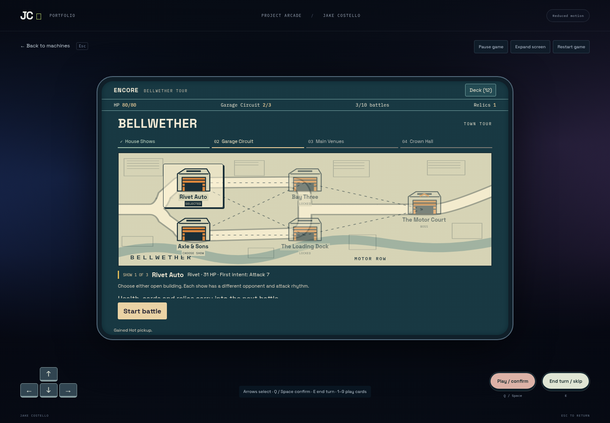
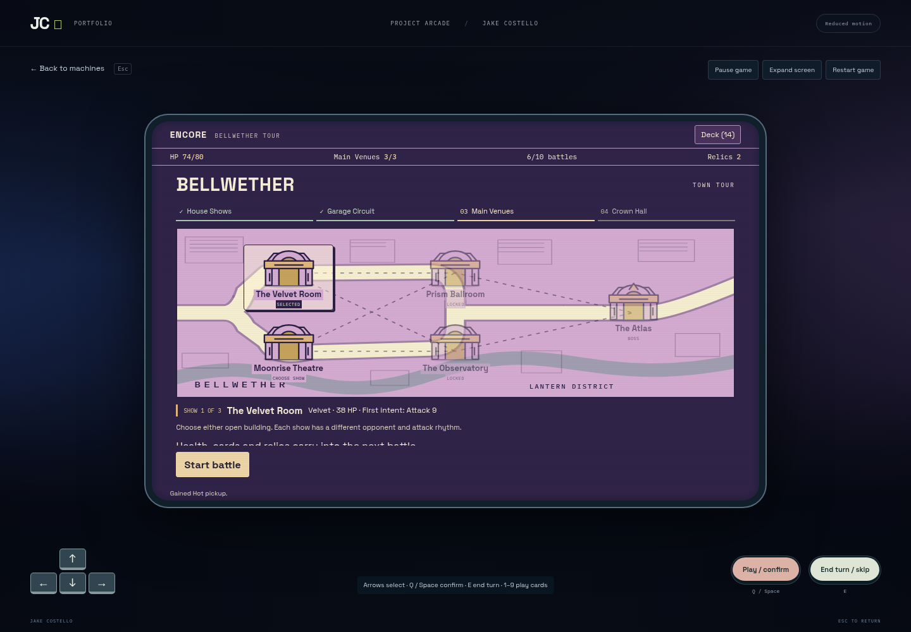
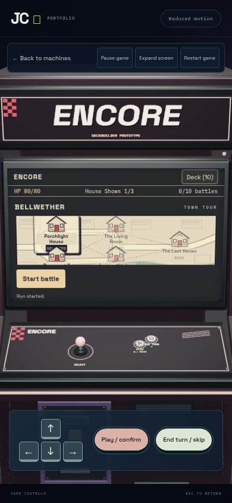
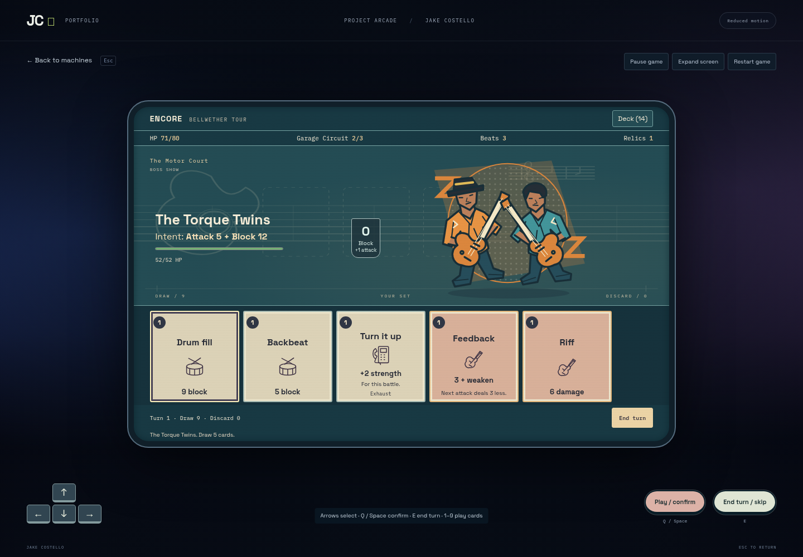
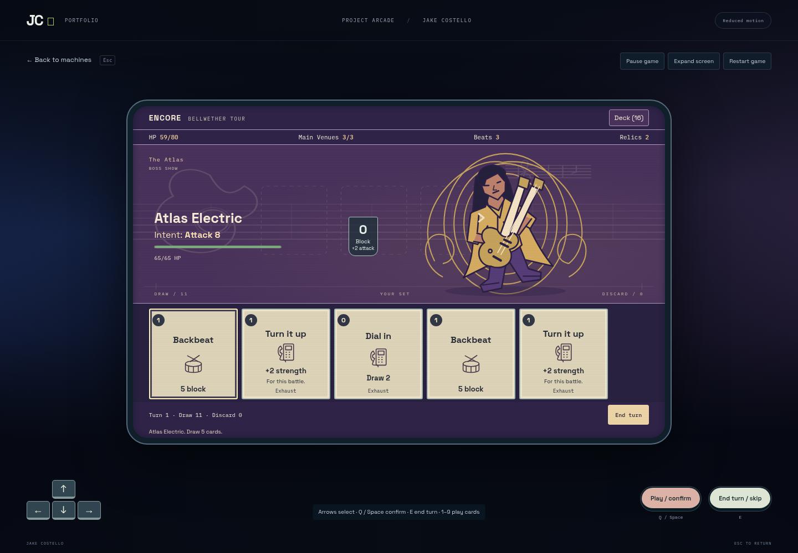
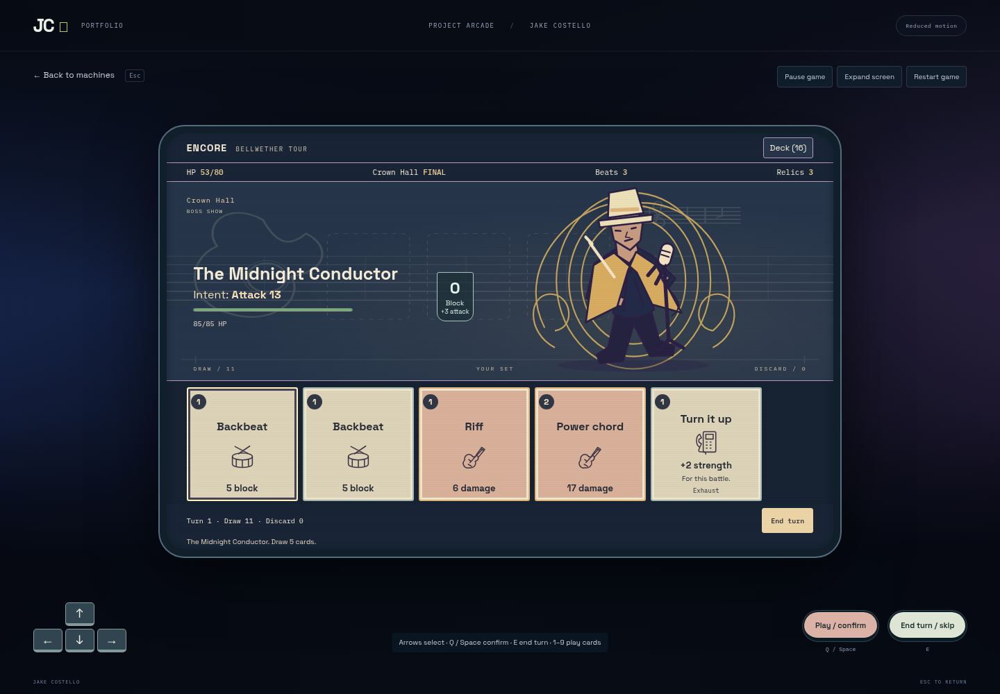
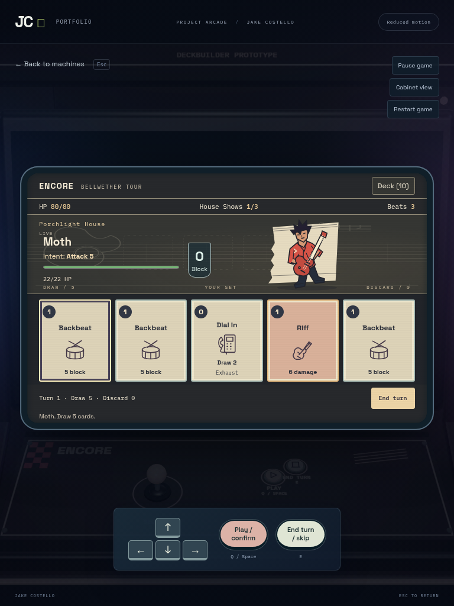
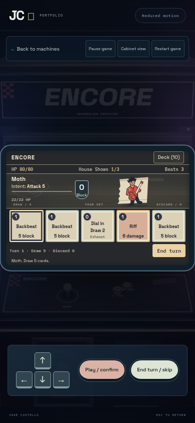
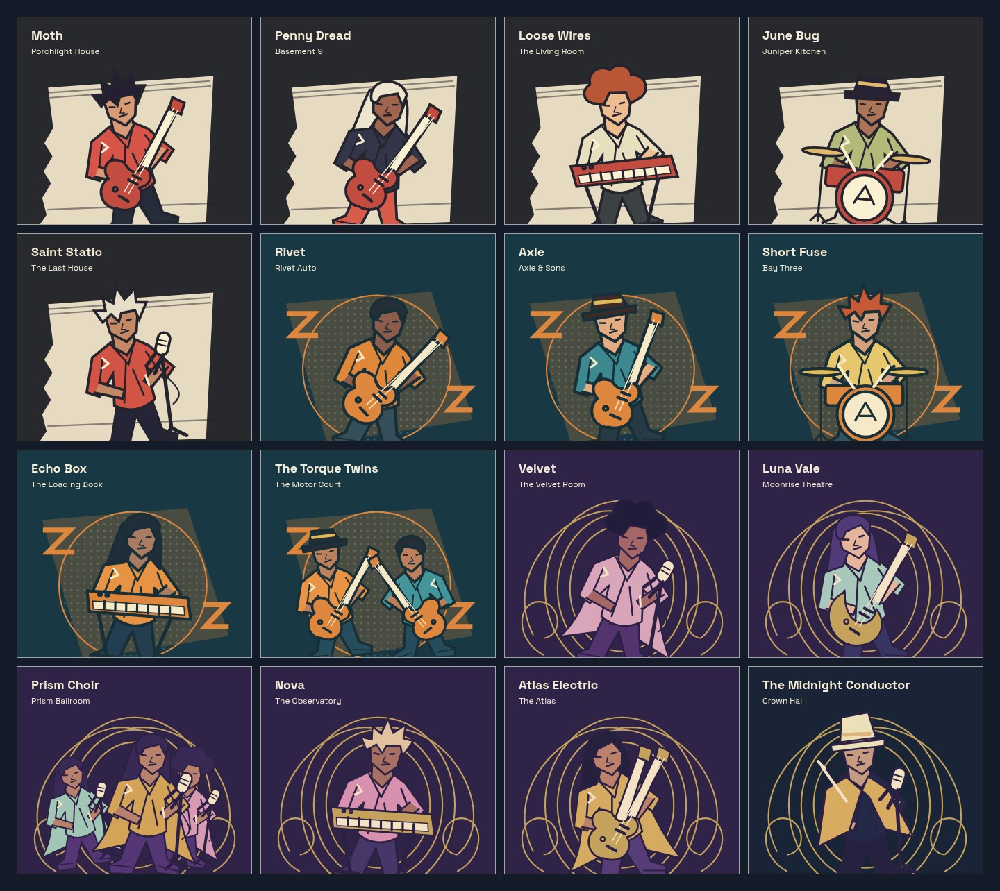

# Bellwether: town, board and performers

[Rules and limits](../ENCORE-BELLWETHER.md). Original SVG art; screenshots use local
Vite and mocked/local services. Node 24.22.1, Chromium 156, DPR 1, one browser
worker, reduced motion. Desktop 1440×1000, tablet 768×1024, mobile 390×844.

## Town and compact cabinet

The map offers real alternate opponents at six stops, then converges at bosses.
Compact view scrolls details while keeping Start battle outside the scroller;
Expand screen shows the larger map. Capture probes verified no horizontal game
overflow and visible End turn at all three viewports.

## Board and district treatments

## Sixteen performers

The contact sheet is an asset harness, not injected game state. Combat/map images
come from real UI runs; the latter complete all ten encounters. Shared performer
and instrument primitives are deliberate; this is stylized vector art, not a
claim of sixteen hand-painted or frame-animated sprites.

## Checkpoint evidence

- 124 unit tests and production build pass; the existing large renderer warning remains.
- The desktop/mobile Encore suite passes twelve tests, including full runs,
  alternate show selection, deck-inspector focus/choice retention, physical
  controls, pause, reduced motion, lazy import and error recovery.
- Responsive capture checks pass desktop/tablet/mobile; the contact sheet passes
  once on desktop, with two intentional repeat skips. Its first harness attempt
  failed on a CommonJS interop import; the import was corrected and rerun.
- Local backend discovery failed because `networkx` is absent from this frontend
  environment. No backend dependency/service setup was added; backend CI is the gate.
- Full frozen arcade/site CI and deployment status are recorded in the PR and
  workspace report; this checkpoint alone does not claim publication.

Encore remains lazy-loaded. Its JS is about 35 kB / 12 kB gzip; the prior draft
was about 15 kB / 5.6 kB gzip. The original SVG data accounts for most of that
increase. No new package, image download, Three.js geometry/texture, light,
postprocessing pass or animation loop is added. Real-device FPS, screen-reader
behavior and player-rated balance are not certified by these checks.

No save/resume, shop/rest/event nodes, upgrades, new card/relic pool, music or
boss-specific rule expansion yet. These remain the next gameplay pass.
