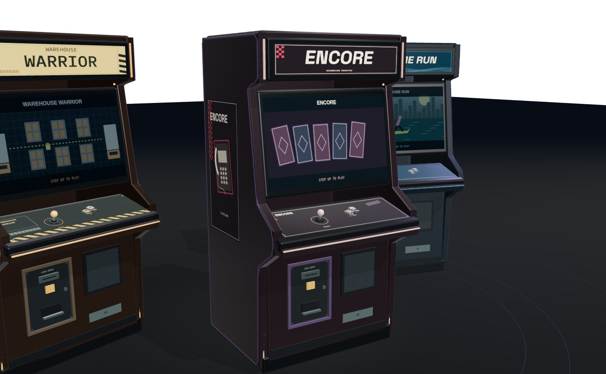
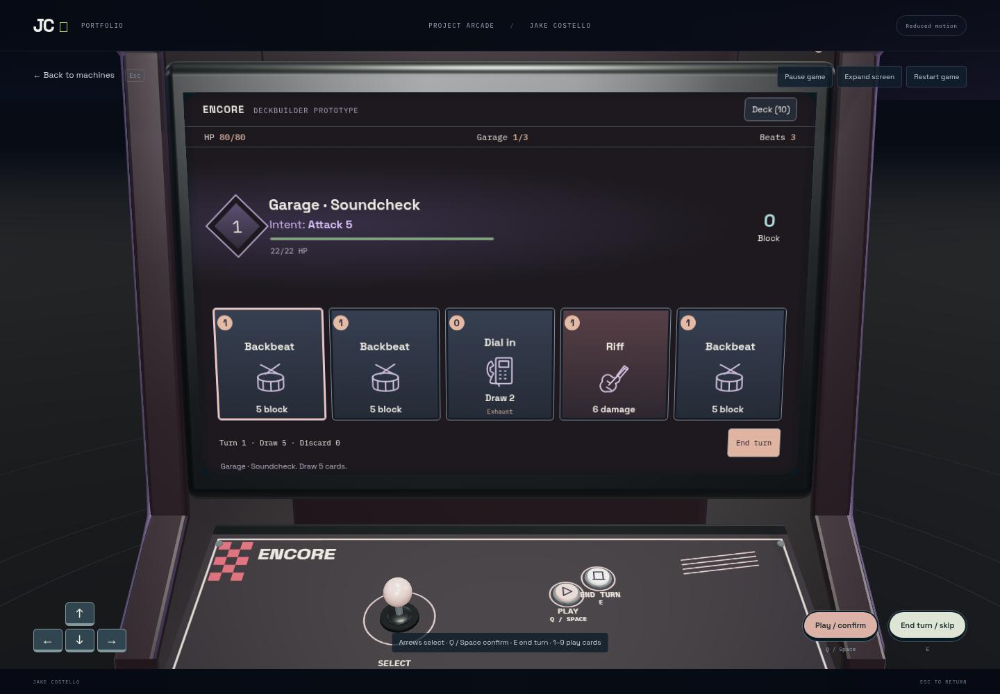
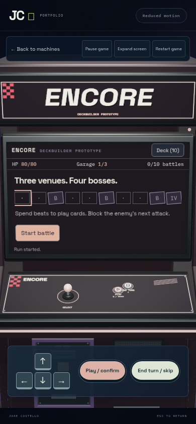
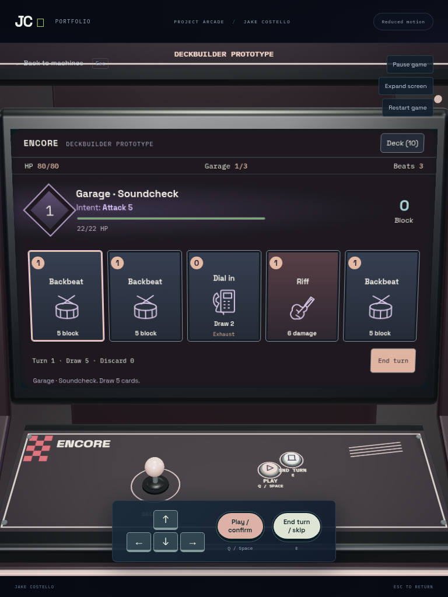
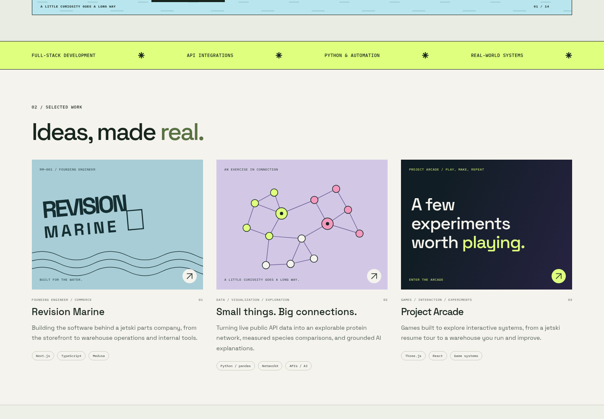
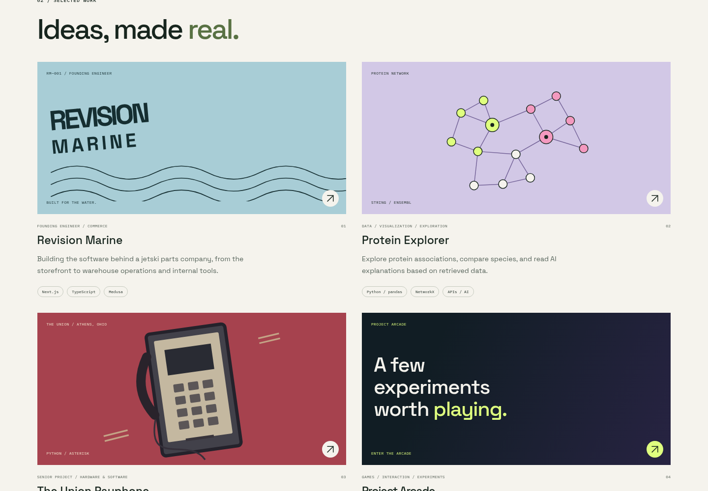
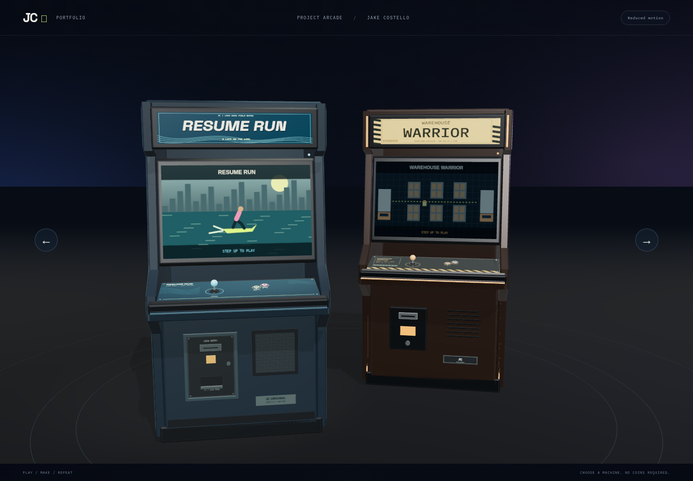
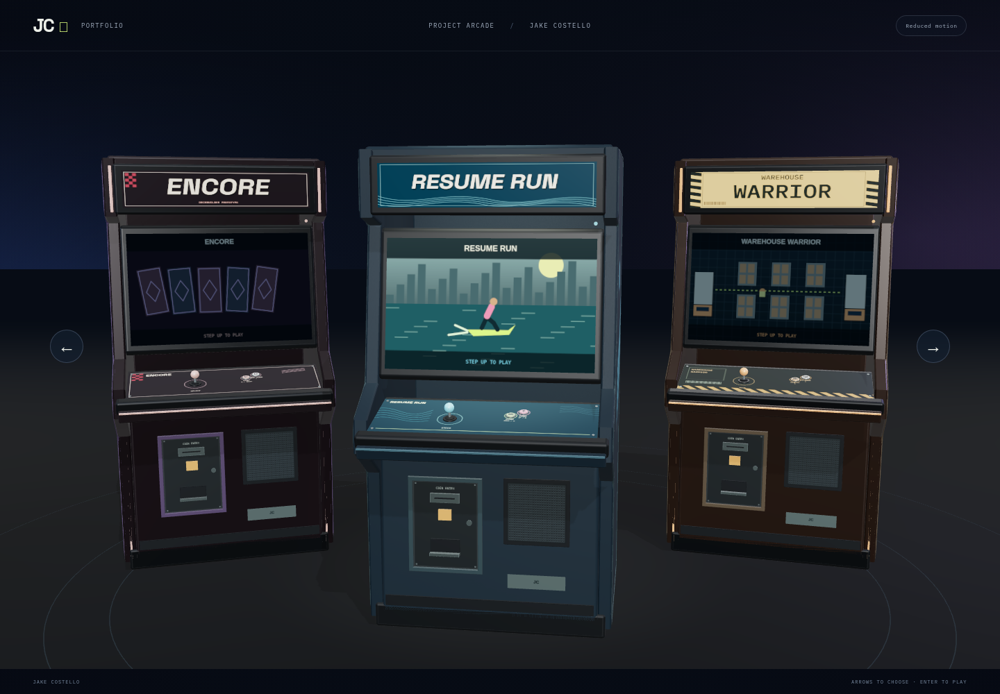

# Encore and first copy pass: evidence checkpoint

Base `c0f30af6f42918d2471eb676f32d2b8f31b50abc`; branch `feat/deckbuilder-and-copy`.
[Game rules and backlog](../ENCORE-PROTOTYPE.md) · [copy coverage](../COPY-PASS-2026-11-13.md).
This is a first playable draft, with original payphone/gig-poster art, nine cards,
three relics, three world bosses and a separate final boss. No new dependencies,
services, paid API jobs, audio or production form/API calls. The payphone senior
project remains in Athens; Cleveland informs the game theme.

## New cabinet and combat

## Portfolio and lobby

Before portfolio:

After portfolio:

Before lobby:

After lobby:

## Rendering cost

Same cloud host / system Chromium 156.0.8078.79, Node 24.22.1, DPR 1, reduced
motion, one worker. Desktop 1440×1000; tablet 768×1024; mobile 390×844. Local
frontend with mocked lab data and external browser traffic denied. Before source
was read from the base commit through a test-only Vite transform; no baseline
source edits were made. The new lobby deliberately has three machines rather
than two, so this is a workload comparison, not identical scene complexity.
Playing samples use Warehouse Warrior at the same screen projection.

| View / mode | Calls before → after | Triangles | Geometries | Textures | Programs |
| --- | --- | --- | --- | --- | --- |
| desktop lobby | 147 → 209 | 51,344 → 68,624 | 98 → 135 | 22 → 34 | 10 → 10 |
| desktop playing | 82 → 60 | 33,070 → 21,816 | 98 → 135 | 22 → 34 | 11 → 11 |
| tablet lobby | 145 → 177 | 51,280 → 62,284 | 96 → 114 | 22 → 32 | 10 → 10 |
| tablet playing | 85 → 66 | 34,510 → 23,452 | 98 → 135 | 22 → 34 | 11 → 11 |
| mobile lobby | 108 → 138 | 41,194 → 56,358 | 73 → 87 | 16 → 21 | 10 → 10 |
| mobile playing | 96 → 73 | 38,250 → 24,828 | 98 → 112 | 22 → 29 | 11 → 11 |

The third cabinet adds lobby work and resources. Gameplay draws only the active
cabinet, reducing submitted calls/triangles. CPU geometry buffers rise from
2,141,520 to 2,567,984 bytes. Counts are renderer submissions/allocations, not unique
model polygon totals or GPU byte measurements. Raw JSON includes 12 forced-frame
intervals; these short software-GPU diagnostics do not certify device FPS or
statistically reliable timing. No extra lights, shadow passes, postprocessing or
permanent animation loop. Real-device frame pacing and GPU retention remain open.

## Validation at this checkpoint

- Typecheck, 120 frontend unit tests and production build pass. Existing renderer
  chunk-size warning remains. Encore JS is about 15 kB / 5.6 kB gzip, lazy-loaded.
- New Encore suite: 8 passes across desktop/mobile, including full ten-encounter
  runs using native UI without WebGL, pause/reset, physical controls, lazy loading,
  complete mobile Start visibility, 10/10 victory and focused load-failure exit.
- Existing arcade suite: 28 pass / 7 expected skips / 1 held-button failure during
  a hot update. Trace confirms ArcadeHub hot reload during that press; frozen
  rerun passes. All other old arcade cases passed.
- Portfolio/navigation/new-game combined run: 40 pass / 4 expected skips / 4 stale
  expectation failures (old chapter title and previously absent payphone card).
  Updated assertions retain positive content/visibility checks; targeted rerun:
  4 pass. Initial chapter traversal itself passed before the stale heading check.
- Final capture suite: desktop/tablet/mobile pass. A baseline mobile capture first
  tried to click an offscreen carousel neighbour; corrected to use Next machine,
  then rerun passed. An intermediate capture was stopped for that harness fix.
- Workbench: 10 tests, 21 skills / 593 locked files pass; its PR #4 checks pass.
- Full frozen PR CI is still the merge gate at this evidence checkpoint. No merge
  or deployment is claimed here; final status belongs to the PR/workspace report.

The final UI replaces missing font symbols with SVG art, keeps the mobile Start
button outside the scrolling details region, fixes final completion count, and
avoids filler slogans. This is one-agent self-review, not an independent review,
accessibility certification or proof of fun/balance. No save/resume, branching
routes, authored music or final boss illustrations are claimed in this draft.
