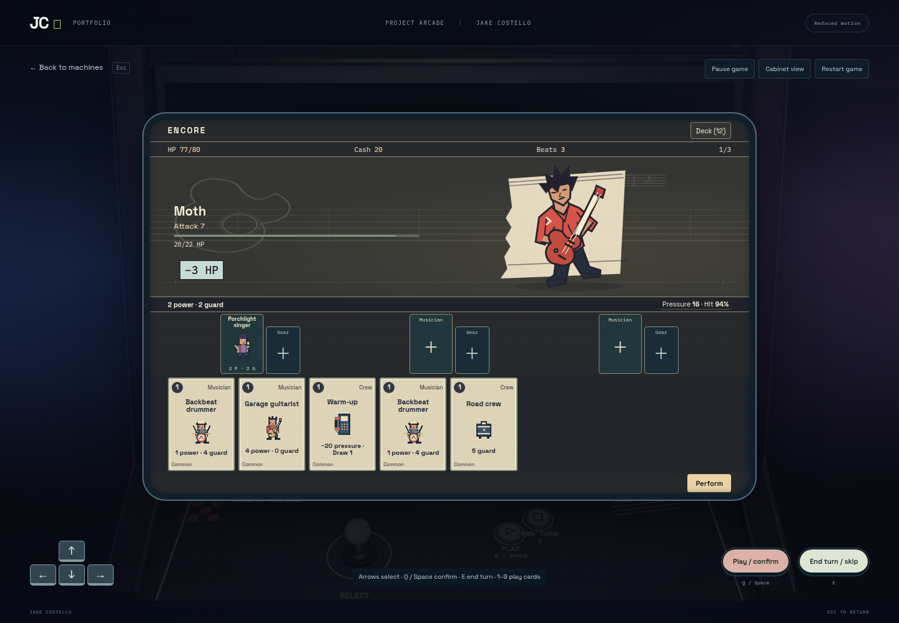
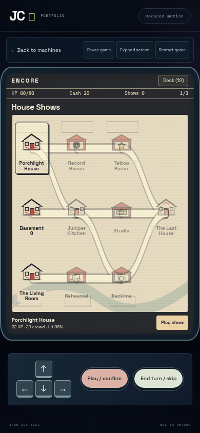
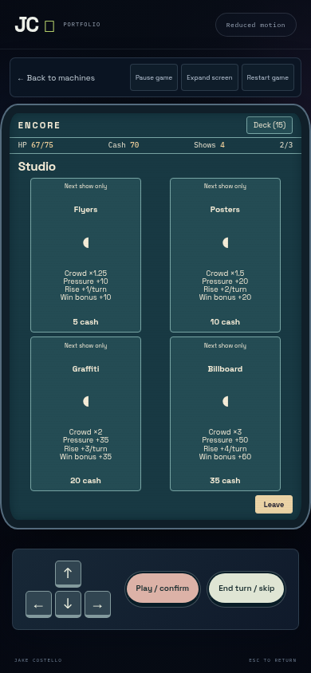
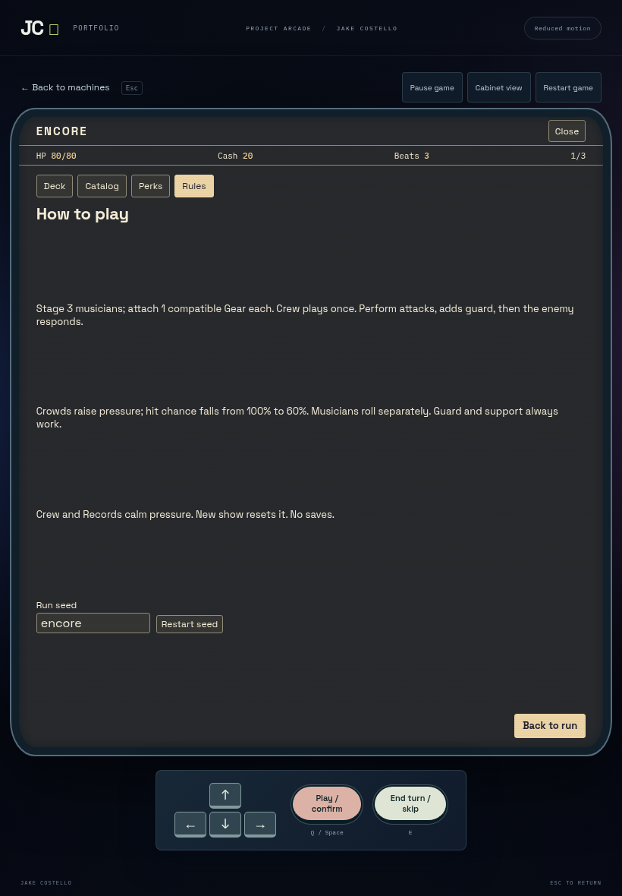

# Encore: roads, pressure and a monitor-sized board

This iteration replaces the free-choice town and automatic between-show stops.
It keeps the original Bellwether rock-band setting, card identities and replaceable
art contract. It is a playable prototype, not a claim of finished game balance.

## Playable changes

- Three road lanes in each district, with two crossovers. Only outgoing roads can
  be traveled. A visited location cannot be replayed. All complete routes cross
  the House, Garage and Venue bosses, then Crown Hall. Routes contain 7–10 shows.
- Record House, Tattoo Parlor, Backline, Studio and Rehearsal are map locations.
  There is no automatic shop menu after a show. Reward/Record selection returns
  to the next connected road. After the third boss, three preparation locations
  lead to the final show; there is no Studio before that final to sell a useless
  completion payout. Locations resolve once.
- Musicians and their Gear occupy portrait card slots. Combat fits the cabinet
  screen; rewards, shops and the inspector use pages. No vertical game scrolling.
  The hand can move horizontally, with cabinet arrows/keyboard and touch.
  Turn/draw/discard text and visible routine combat narration are removed; screen
  readers retain concise status announcements. The turn action is **Perform**.
- Pressure starts at 10 / 25 / 40 across the districts, 50 at Crown Hall. It rises
  by 6 / 8 / 10 / 12 after each enemy response, capped at 100. Hit chance is
  `100 - round(0.4 * pressure)`, so it remains between 100% and 60%.
  Each musician makes a separate damage roll; damaging Crew makes one roll.
  Guard, draw, weaken and pressure relief always resolve. Misses are seeded from
  a separate stream, so they do not change draw/reward/shop randomness. No hidden
  HP tax, enemy stat inflation or attack damage bonus is attached to promotion.
- Warm-up (common Crew) lowers pressure by 20 and draws one; Steady hands (rare
  Crew) lowers it by 35 and gives three guard. The starter replaces one duplicate
  Riff with Warm-up. Private rehearsal (common Record) lowers opening pressure by
  25; Room tone (rare Record) lowers its per-turn rise by three. Relief clamps at
  zero. Rehearsal offers a 10-HP rest or 20 less pressure for the next show.
- Studio books one campaign for the next show: Flyers costs 5 (crowd ×1.25,
  pressure +10, rise +1, win bonus +10); Posters 10 (×1.5/+20/+2/+20); Graffiti
  20 (×2/+35/+3/+35); Billboard 35 (×3/+50/+4/+60). It is optional earned game
  cash, with no account, real payment, external service or production API.
  Campaigns expire after that show and their bonus pays once, only on a win.
- The pool now has 20 cards: six musicians, six Gear and eight Crew. There are
  11 Records. Existing matte/silver/prismatic labels, compatible targeting,
  cancellation, upgrade caps, exact mystery odds and three Record slots remain.

## Art and architecture

`band-cards.ts` owns card definitions; `deckbuilder-model.ts` owns run rules;
`tour-map.ts` owns connected locations; `tour-promotions.ts` owns campaign data.
Existing `encore-art-registry.ts` maps stable art keys to local illustrations.
New Crew temporarily reuse existing icons. Hand-drawn cards/backgrounds can still
be substituted without changing names, rules or stats. See the prior
[art contract](../encore-band-system/README.md#replace-the-art-by-hand).
No runtime package, service, AI API or backend change is required.

## Verification

Use Node 24. `npm run typecheck`, `npm test`, `npm run build`, backend unittest
and existing Playwright suites. The Encore browser suite checks actual UI input,
full legal-road completion, shops/Studio/event, pressure relief, targeting/cancel,
keyboard/cabinet controls, pause/reset, art failure and catalog pagination. It
measures overflow and control bounds, including 320×568, phone portrait, tablet
portrait/landscape, expanded/fallback and the actual 3D cabinet. One local worker,
local/mocked services and denied external browser traffic.

`npx tsx tools/encore-balance/run.ts /tmp/encore-pressure` executes the actual reducer,
three visible-information policies, four route policies, 100 shared seeds per
policy, and a 1,800-action cap. It also compares 100 Studio-route seeds per policy
with/without Flyers, giving 900 finite runs total. Outputs include hits/misses,
maximum miss streak, paths, cash and termination. These are bot evidence, not
human playtests, optimal play or proof of enjoyment. Report raw evidence outside
source under `/workspace/review-artifacts/encore-pressure-2026-11-14/`.

The four-route sample won 84/100 offense, 100/100 defense and 99/100 setup runs.
All 900 runs terminated. In the paired Studio sample, offense won 55/100 without
Flyers and 51/100 with them; defense/setup each won 99/100 in both conditions.
Flyers increased misses and mean cash. These samples do not establish a reliable
human win rate or significance. Passive guard and stacked relief can dominate;
future balancing should compare other purchases/campaigns and human reactions
to misses, rather than tuning solely to these heuristics.

## Next playtest questions

1. Can a new player predict road choices and shop opportunity costs without help?
2. Do separate musician rolls, visible hit odds and pressure cards make misses
   understandable, or does failure still feel arbitrary? Sampled streaks reached
   six consecutive misses. Consider a disclosed mitigation only after observations.
3. Do passive guard and stacked pressure Records erase late-show decisions?
4. Do phone players prefer expanded mode for reading cards? The physical cabinet
   intentionally shows a much smaller monitor; expanded mode keeps full rules.
5. Validate higher campaigns, other shop policies, human keyboard/screen-reader
   use and real iOS/Safari. Chromium phone emulation is not hardware validation.

## Local screenshots

Captured from the actual browser UI with reduced motion; no generated mockups.
The tablet view shows the inspector; the tests also measure map/combat bounds.

